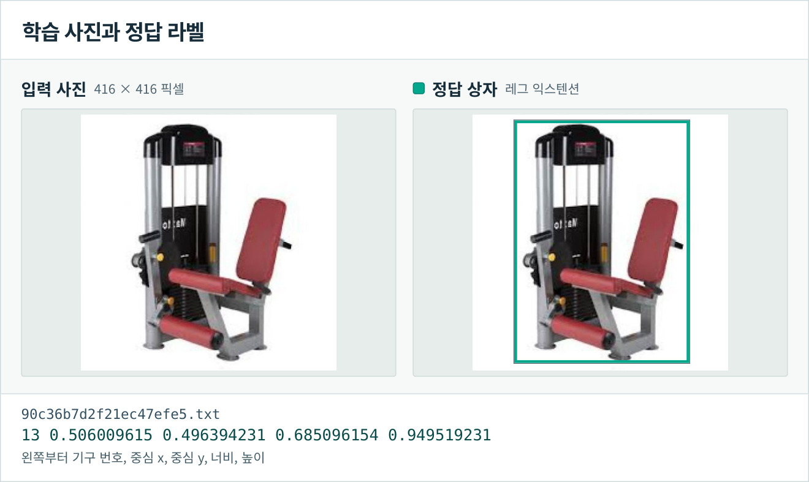
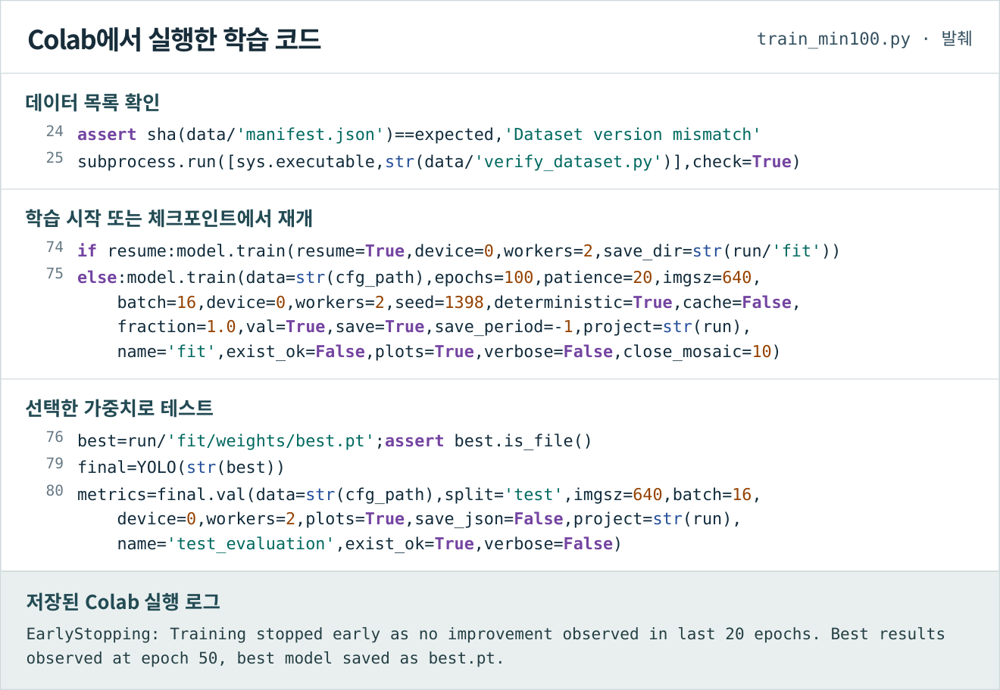
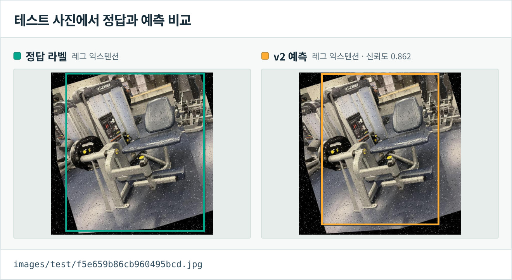

# 1398피트니스센터 운동기구 인식

이 모델은 헬스장 사진에서 26종 운동기구의 종류와 위치를 찾습니다. 예를 들어 트레드밀과 레그 컬 머신이 함께 찍혔다면, 앱에서 각 기구 위에 이름과 상자를 표시할 수 있습니다. 성균관대 1398피트니스센터의 기구 목록을 기준으로 학습했으며, 센터에서 직접 촬영한 사진을 이용한 성능 검증은 남아 있습니다.

**2026년 11월 24일 v2 보강 실험**에서는 기존 테스트 AP50이 90% 미만인 6종에 516장을 추가해 각 200장으로 학습했습니다. 같은 테스트 205장에서 전체 mAP50은 91.85%에서 92.01%로, mAP50–95는 79.67%에서 76.90%로 바뀌었습니다. 펙토럴 플라이는 74.63%에서 95.50%로 올라갔고 체스트 프레스는 89.34%에서 78.12%로 내려갔습니다. [보강 모델·기구별 성능·현장 검증 과제](SKKU_1398_Fitness_ML/04_exports_and_reports/equipment26_min200_20261124/README.md)

| 하려는 일 | 먼저 열 파일 |
| --- | --- |
| 새 모델로 사진 한 장에서 상위 1~26종 표시하기 | [보강 모델 사용 예제](SKKU_1398_Fitness_ML/04_exports_and_reports/equipment26_min200_20261124/README.md) · [26종 전체 비교표](SKKU_1398_Fitness_ML/04_exports_and_reports/equipment26_min200_20261124/metrics/per_class_26.csv) |
| 라벨 좌표와 학습 에포크 확인하기 | [픽셀 상자 변환 예제 · v1/v2 설정 · 실제 조기 종료 로그](docs/LABELING_AND_TRAINING.md) |
| 실제 사진과 코드로 학습 과정 보기 | [학습 사진 · 정답 라벨 · Colab 코드 · 테스트 예측](#사진으로-따라가는-v2-학습-과정) |
| **관심 있는 종목의 수집량과 실제 학습량 확인하기** | [26종 기구별 수집 후보와 v1·v2 학습·검증·테스트 사진 수](TRAINING_DATA.md) |
| 모바일 앱에 26종 기구 인식 넣기 | [v2 TFLite 모델](SKKU_1398_Fitness_ML/04_exports_and_reports/equipment26_tflite_20261101T034127Z/equipment26_fp32.tflite) · [출력 번호와 한글 기구명 대응표](SKKU_1398_Fitness_ML/04_exports_and_reports/equipment26_tflite_20261101T034127Z/class_mapping.json) |
| Python에서 기구 인식 모델 사용하기 | [v2 가중치 best.pt](SKKU_1398_Fitness_ML/03_training_runs/equipment26_min100_retrain_20261101T020110Z/fit/weights/best.pt) |
| Colab에서 26종 모델 학습 과정 따라가기 | [재학습 노트북](SKKU_1398_Fitness_ML/01_notebooks/equipment26_min100_round1_20261101.ipynb) · [데이터 준비 기록](SKKU_1398_Fitness_ML/02_dataset) |

## 사진으로 따라가는 v2 학습 과정

### 1. 어떤 사진을 골랐고 무엇을 정답으로 삼았나

공개 데이터셋의 기구 이름을 센터의 26종 목록에 대응시킨 뒤, 사진 속 기구와 정답 상자가 맞는지 검수했습니다. 예를 들어 리컴번트 바이크 후보에 업라이트 바이크가 섞였거나 상자가 기구 대신 사람을 둘러싼 사진은 검수에서 보류하거나 제외했습니다. v2용 메가맥스 자료는 가이드 레일을 따라 움직이는 바와 별도 프리웨이트 랙 기능을 함께 갖춘 기구를 골랐습니다. [검수 사례](SKKU_1398_Fitness_ML/02_dataset/SKKU1398_equipment_v1/reports/BUILD_RESULT_KO.txt) · [v2 기구 선별 기준](SKKU_1398_Fitness_ML/03_training_runs/equipment26_min100_retrain_20261101T020110Z/selection_criteria_ko.txt)

아래 두 칸은 v2 학습 세트에 들어간 **같은 레그 익스텐션 사진**입니다. 모델은 왼쪽 사진을 입력받고, 오른쪽 상자의 위치와 기구 종류를 맞히도록 학습합니다.

사진과 같은 파일명의 `90c36b7d2f21ec47efe5.txt`가 정답 파일입니다. 첫 값 `13`은 26종 목록에서 레그 익스텐션을 가리킵니다. 다음 네 값은 사진 크기를 1로 볼 때 상자의 중심 x·y, 너비, 높이입니다. 예를 들어 너비 `0.685096154`는 상자가 사진 폭의 약 69%를 차지한다는 뜻입니다. 이 샘플은 v2 데이터 목록에 검수 승인(`approved`)과 학습용(`train`)으로 기록돼 있습니다. [26종 번호 대응표](SKKU_1398_Fitness_ML/03_training_runs/equipment26_min100_retrain_20261101T020110Z/class_mapping.json) · [데이터 선별·검수 기록](SKKU_1398_Fitness_ML/02_dataset/SKKU1398_equipment_v1/reports/BUILD_RESULT_KO.txt)

메가맥스 추가 사진에서는 600×600 이미지에 기록한 두 모서리 (24, 18)과 (528, 576)를 실제 YOLO 라벨 `24 0.460000 0.495000 0.840000 0.930000`으로 변환했습니다. [라벨을 만든 과정과 픽셀 계산 예제](docs/LABELING_AND_TRAINING.md)

학습 사진 출처는 xuejun-hong의 *gym-equipment* v1입니다. 프로젝트 데이터 목록에 기록된 라이선스는 CC BY 4.0입니다. 같은 이미지를 축소해 배치하고 오른쪽에 정답 상자를 표시했습니다. [데이터셋](https://universe.roboflow.com/xuejun-hong/gym-equipment-iv6k9/dataset/1) · [라이선스](https://creativecommons.org/licenses/by/4.0/)

### 2. 이 사진과 라벨이 Colab 코드에 어떻게 들어갔나

데이터 준비 스크립트는 기존 24종 자료, 26종 확장 자료, v2 추가분을 읽어 `images/train`과 `labels/train`에 사진과 정답을 짝지어 놓습니다. 검증용(`val`)과 테스트용(`test`)도 각각 별도 폴더에 둡니다. 학습 코드는 파일 목록의 SHA-256을 확인한 뒤, 어떤 폴더를 어떤 용도로 읽을지 적힌 `data_train.yaml`을 YOLO에 전달합니다. [데이터 준비 코드](SKKU_1398_Fitness_ML/02_dataset/SKKU1398_equipment_v1/yolo/prepare_equipment26_min100_v2.py) · [실제 학습 설정 파일](SKKU_1398_Fitness_ML/03_training_runs/equipment26_min100_retrain_20261101T020110Z/data_train.yaml)

v2 학습은 v1의 `best.pt`에서 출발했습니다. 사진을 640×640 입력으로 준비해 한 번에 16장씩 처리하고, 모델이 예측한 상자와 기구 종류를 정답과 비교하며 가중치를 갱신했습니다. 최종 Colab 실행은 저장된 체크포인트에서 이어졌습니다. 검증 지표가 가장 좋았던 시점은 **50번째 에포크**였고, 이후 20회 동안 개선되지 않아 70번째에서 학습을 마쳤습니다. 코드는 선택된 `best.pt`를 다시 열고 테스트 사진 205장에서 평가했습니다. 그림은 저장된 스크립트와 Colab 실행 로그의 해당 줄을 발췌해 읽기 쉽게 줄바꿈한 것입니다. [학습 코드 원문](SKKU_1398_Fitness_ML/03_training_runs/equipment26_min100_retrain_20261101T020110Z/train_min100.py) · [에포크별 학습 곡선](SKKU_1398_Fitness_ML/03_training_runs/equipment26_min100_retrain_20261101T020110Z/fit/results.png) · [실행 노트북](SKKU_1398_Fitness_ML/01_notebooks/equipment26_min100_round1_20261101.ipynb)

v1의 실행 기록은 최대 60회 중 16회 학습, 최적 가중치는 1회차였습니다. v2는 최대 100회 중 70회 학습, 최적 가중치는 50회차였습니다. [버전별 설정, 에포크별 그래프와 실제 로그](docs/LABELING_AND_TRAINING.md#v1과-v2는-몇-에포크-학습했나)

### 3. 학습에 쓰지 않은 사진에서 무엇을 찾았나

아래는 v2 **테스트 세트의 다른 사진**입니다. 왼쪽은 라벨 파일에 적힌 정답이고, 오른쪽은 저장소의 앱용 TFLite 모델에 같은 사진을 넣어 이번에 얻은 예측입니다. 배경에 다른 기구가 보이는 사진에서도 모델은 레그 익스텐션에 상자를 표시했습니다.

모델이 출력한 **0.862**는 이 상자를 레그 익스텐션으로 탐지한 신뢰도입니다. 이 예시에서는 신뢰도 0.25 이상인 후보를 남기고, 같은 종류의 상자가 겹치면 NMS 기준 0.45를 적용했습니다. 전체 모델 성능은 아래의 기구별 테스트 결과에서 확인할 수 있습니다. [실행한 TFLite 모델](SKKU_1398_Fitness_ML/04_exports_and_reports/equipment26_tflite_20261101T034127Z/equipment26_fp32.tflite) · [변환 모델 검증 코드](SKKU_1398_Fitness_ML/04_exports_and_reports/equipment26_tflite_20261101T034127Z/validate_tflite.py)

테스트 사진 출처는 rizzlabzz의 *GymBro* v2입니다. 프로젝트 데이터 목록에 기록된 라이선스는 CC BY 4.0입니다. 같은 이미지를 축소해 정답 상자와 예측 상자를 각각 표시했습니다. [데이터셋](https://universe.roboflow.com/rizzlabzz/gymbro/dataset/2) · [라이선스](https://creativecommons.org/licenses/by/4.0/)

## 기구 인식 v1과 v2의 차이

**v2에서는 메가맥스 사진 107장과 더블 트위스트 사진 61장을 추가해 총 3,537장으로 재학습했습니다.** 다른 24종의 학습·검증·테스트 사진 수는 같았습니다. 5종 초기 실험과 24종 학습을 거쳐 메가맥스와 더블 트위스트를 더한 첫 26종 모델이 이 문서의 **v1**입니다. **v2**는 같은 YOLO11n 구조와 같은 26종을 유지하면서 두 기구의 사진을 보강한 모델입니다. [5종 초기 프로젝트](SKKU_1398_Fitness_ML/01_notebooks/SKKU_1398_Colab_Project) · [24종에서 26종으로 확장한 기록](SKKU_1398_Fitness_ML/03_training_runs/equipment26_yolo11n_20261031T125943Z/initialization.json)

| 데이터 구성 | v1 · 2026년 10월 31일 | v2 · 2026년 11월 1일 |
| --- | ---: | ---: |
| 전체 사진 | 3,369장 | 3,537장 |
| 학습 / 검증 / 테스트 사진 | 2,969 / 200 / 200장 | 3,128 / 204 / 205장 |
| 메가맥스 학습 / 테스트 사진 | 2 / 0장 | 100 / 5장 |
| 더블 트위스트 학습 / 테스트 사진 | 39 / 4장 | 100 / 4장 |
| 테스트 사진으로 평가한 기구 | 25종 | 26종 |

메가맥스가 대표적인 예입니다. v1에는 메가맥스 테스트 사진이 한 장도 없어 처음 보는 사진에서 이 기구를 찾는지 확인할 수 없었습니다. v2는 메가맥스 사진 100장으로 학습하고 별도 사진 5장으로 평가했습니다. 26종 모두 학습 사진은 100장 이상이지만, 기구별 테스트 사진은 적게는 한 장이므로 관심 있는 기구의 점수와 표본 수를 함께 보세요. [v1 데이터 구성](SKKU_1398_Fitness_ML/03_training_runs/equipment26_yolo11n_20261031T125943Z/summary.json) · [v2 데이터 구성](SKKU_1398_Fitness_ML/03_training_runs/equipment26_min100_retrain_20261101T020110Z/summary.json)

### 어떤 성능 지표를 보면 되나요?

| 궁금한 점 | 지표 | v1 | v2 |
| --- | --- | ---: | ---: |
| 표시한 상자 중 기구를 올바르게 찾은 비율은? | 정밀도 (Precision) | 94.20% | 93.50% |
| 사진에 실제로 있는 기구 중 찾아낸 비율은? | 재현율 (Recall) | 82.92% | 86.94% |
| 위치까지 고려한 평균 탐지 점수는? | mAP50 | 0.9154 | 0.9185 |
| 상자 위치를 더 엄격하게 평가하면? | mAP50–95 | 0.8065 | 0.7967 |

mAP50은 예측 상자와 정답 상자의 겹침 비율(교집합 ÷ 합집합)이 50% 이상일 때 위치가 맞았다고 봅니다. mAP50–95는 이 기준을 50%에서 95%까지 바꿔 가며 구한 평균입니다. 각 버전의 테스트에서 v2는 실제 기구를 찾아낸 비율이 높았고, 표시한 결과 중 정답의 비율은 소폭 낮았습니다. 테스트 사진과 평가 대상이 달라 두 수치의 차이를 그대로 모델의 성능 향상 폭으로 해석하기는 어렵습니다. [v1 기구별 결과](SKKU_1398_Fitness_ML/03_training_runs/equipment26_yolo11n_20261031T125943Z/test_metrics.json) · [v2 기구별 결과](SKKU_1398_Fitness_ML/03_training_runs/equipment26_min100_retrain_20261101T020110Z/test_metrics.json)

기구별 수집 후보 수와 실제 학습에 쓴 사진 수가 궁금하다면 두 수치를 함께 확인하세요. [기구 26종 전체 비교표](TRAINING_DATA.md)

## 앱에서 사진을 기구 이름과 위치로 바꾸기

아래는 11월 1일 v2의 원시 탐지 출력 규격입니다. 11월 24일 보강 모델은 원본 크기의 RGB 사진을 받아 크기 변환을 내부에서 처리하며, 기구별 최고점 26개와 각 점수에 대응하는 상자를 반환합니다. [보강 모델 입력·출력과 Top‑K 예제](SKKU_1398_Fitness_ML/04_exports_and_reports/equipment26_min200_20261124/README.md#앱-입력과-출력)

1. **사진을 준비합니다.** 원본 비율을 유지해 크기를 조정하고 여백을 더해 640×640으로 만듭니다. RGB 값을 255로 나눠 0~1 범위로 맞춘 뒤, 이미지 한 장을 `float32 [1, 3, 640, 640]` 형태로 전달합니다.
2. **모델의 출력값을 읽습니다.** 출력 형태는 `[1, 30, 8400]`입니다. 8,400개 후보 각각에 상자 좌표 4개와 기구별 점수 26개가 들어 있습니다. 후보마다 점수가 가장 높은 기구의 번호를 한글 이름으로 바꿉니다. [라벨 순서](SKKU_1398_Fitness_ML/04_exports_and_reports/equipment26_tflite_20261101T034127Z/labels.txt) · [한글 기구명](SKKU_1398_Fitness_ML/04_exports_and_reports/equipment26_tflite_20261101T034127Z/class_mapping.json)
3. **원본 사진 위에 결과를 표시합니다.** 점수가 낮은 후보를 걸러내고, 같은 기구에 겹친 상자는 점수가 높은 상자를 남깁니다(NMS). 입력 때 더한 여백과 크기 변화를 역으로 적용해 원본 사진에 상자와 이름을 그립니다. 남은 후보가 없으면 빈 목록을 반환합니다. [입출력 규격](SKKU_1398_Fitness_ML/04_exports_and_reports/equipment26_tflite_20261101T034127Z/input_output_spec.json) · [TFLite 변환 후 검증 결과](SKKU_1398_Fitness_ML/04_exports_and_reports/equipment26_tflite_20261101T034127Z/validation_report.json)

## Colab에서 학습을 다시 실행하려면

기구 인식 노트북에 적힌 Google Drive 경로에 원본 사진·라벨 자료를 준비한 뒤 학습 셀을 실행하세요. 이미 학습된 모델을 사용하려면 위 표에서 앱용 TFLite 파일 또는 Python용 가중치를 선택하세요. [26종 재학습 노트북](SKKU_1398_Fitness_ML/01_notebooks/equipment26_min100_round1_20261101.ipynb)

## 운동 영상에 관해 논의한 내용

기구별 운동 영상의 출처와 수량을 조사했고, 앱에서 관절 각도를 이용해 피드백을 주는 구현 방식도 비교했습니다. 녹화 후 분석은 촬영이 끝난 영상을 처리해 결과를 보여 주는 방식이고, 실시간 분석은 촬영 중 프레임을 처리해 피드백을 표시하는 방식입니다. 이 내용은 기능 설계 단계의 논의입니다.
