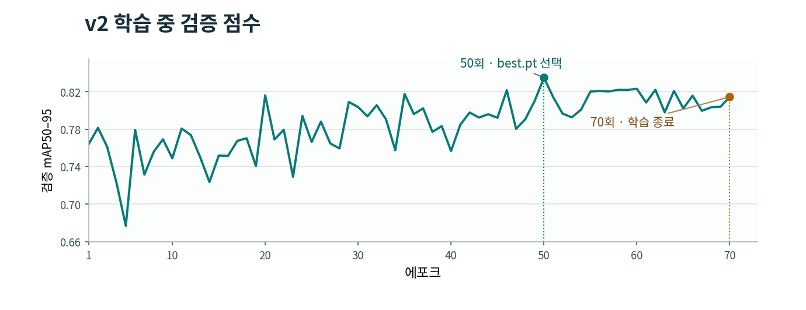

# 기구 사진 라벨링과 학습 설정

## 공개 사진의 라벨을 26종으로 맞추기

사진마다 **기구 종류와 기구 전체의 위치**를 기록했습니다. 한 사진에 대상 기구가 여러 개면 라벨 파일에 상자를 한 줄씩 씁니다. 사진 3,537장에 라벨 파일은 3,537개, 기구 상자는 3,580개입니다.

1. **기존 라벨을 읽습니다.** 원본 데이터셋마다 다른 클래스 번호와 이름을 프로젝트 기구 목록에 대응시켰습니다. 직사각형 라벨은 중심과 너비·높이를 읽고, 외곽선을 점 여러 개로 표시한 폴리곤은 x·y의 최솟값과 최댓값을 이용해 외접 직사각형으로 바꿨습니다. [원본 클래스 대응표](../SKKU_1398_Fitness_ML/02_dataset/SKKU1398_equipment_v1/manifests/source_class_mapping.json) · [변환 코드](../SKKU_1398_Fitness_ML/01_notebooks/build_equipment_v1.py#L91-L110)
2. **상자를 얹어 확인합니다.** 사진 위에 상자를 그린 검수 시트에서 기종이 맞는지, 사람이 아니라 기구 전체가 들어가는지, 사진에 있는 다른 대상이 누락됐는지 살폈습니다. 초기 4종 파일럿에서 대표 이미지 1,080장을 검토한 결과는 승인 203장, 보류 777장, 제외 100장이었습니다. 이는 초기 선별 단계의 수치입니다. 내보내기 코드는 승인한 사진만 선택하고 좌표를 수정한 기록이 있으면 그 상자를 우선합니다. [검수 기록](../SKKU_1398_Fitness_ML/02_dataset/SKKU1398_equipment_v1/reports/BUILD_RESULT_KO.txt) · [승인·좌표 반영 코드](../SKKU_1398_Fitness_ML/01_notebooks/export_reviewed_v1.py#L16-L32)
3. **새로 모은 제품 사진도 구조를 확인합니다.** 메가맥스는 가이드 레일을 따라 움직이는 스미스 바와 별도 프리웨이트 랙 기능이 함께 있는지 보았습니다. 더블 트위스트는 같은 프레임의 회전 발판·좌석 등 구조를 확인했습니다. v2 최종 추가분에는 기구 전체를 둘러싼 픽셀 상자와 검수 결과가 남아 있습니다. 예를 들어 독립 랙 기능이 불분명한 사진, 색상·배경만 바꾼 중복 사진은 제외했습니다. [선별 기준](../SKKU_1398_Fitness_ML/03_training_runs/equipment26_min100_retrain_20261101T020110Z/selection_criteria_ko.txt)
4. **학습 전에 파일과 분할을 검사합니다.** 사진·라벨의 짝, 클래스 번호 0~25, 유한한 좌표, 양수인 너비·높이, 상자 경계를 확인합니다. 최종 검증 기록에서 동일한 이미지 해시는 중복 0건, 확인된 중복 그룹이 학습·검증·테스트 사이에 걸친 경우도 0건입니다. [최종 데이터 검사 결과](evidence/v2-dataset-validation.json)

### 실제 메가맥스 상자 하나를 계산해 보기

최종 추가분의 학습 사진 `min100v2_r123_0.jpg`는 600×600픽셀입니다. 기록된 상자의 왼쪽 위는 `(24, 18)`, 오른쪽 아래는 `(528, 576)`입니다. 기구 번호는 메가맥스의 YOLO 번호 `24`입니다. 센터 기구 목록에서 쓰는 번호는 `19`입니다. [번호 대응표](../SKKU_1398_Fitness_ML/03_training_runs/equipment26_min100_retrain_20261101T020110Z/class_mapping.json)

| 라벨 항목 | 픽셀에서 계산 | 저장값 |
| --- | --- | ---: |
| 중심 x | (24 + 528) ÷ 2 ÷ 600 | 0.460 |
| 중심 y | (18 + 576) ÷ 2 ÷ 600 | 0.495 |
| 너비 | (528 − 24) ÷ 600 | 0.840 |
| 높이 | (576 − 18) ÷ 600 | 0.930 |

실제 `labels/train/min100v2_r123_0.txt`의 내용입니다.

```text
24 0.460000 0.495000 0.840000 0.930000
```

검수 기록의 원본 경로는 `equipment26_min100_v2_update.zip` 안의 `equipment26_min100_v2/update_review/accepted_sources_annotations.json`입니다. 해당 항목 ID는 `r123_0`입니다. [실제 라벨 파일](evidence/min100v2_r123_0.txt)

## v1과 v2는 몇 에포크 학습했나

**에포크 1회**는 학습용 데이터 전체를 한 차례 순회한다는 뜻입니다. 배치 크기 16은 사진을 한 번에 최대 16장씩 처리해 가중치를 갱신한다는 뜻입니다. 각 에포크 뒤에는 별도로 나눈 검증 사진에서 기구 종류와 상자 위치를 얼마나 잘 맞히는지 평가했습니다.

| 실행 항목 | v1 · 첫 26종 모델 | v2 · 사진 보강 후 재학습 |
| --- | --- | --- |
| 출발점 | 24종 YOLO11n에서 공통 가중치 이전 | v1의 26종 `best.pt`에서 추가 학습 |
| 학습 / 검증 / 테스트 | 2,969 / 200 / 200장 | 3,128 / 204 / 205장 |
| 최대 에포크 | 60회 | 100회 |
| 실제 누적 에포크 | **16회** | **70회** |
| 검증 결과가 가장 좋았던 시점 | **1회**, `best.pt`로 선택 | **50회**, `best.pt`로 선택 |
| 조기 종료 기준 (patience) | 15회 연속 개선 없음 | 20회 연속 개선 없음 |
| 입력 / 배치 / GPU | 640×640 / 16 / Tesla T4 | 640×640 / 16 / Tesla T4 |
| 옵티마이저 / 초기 학습률 | AdamW / 0.000333 | AdamW / 0.000333 |
| 실행 시드 | 1398 | 1398 |

v2 최종 Colab 실행은 먼저 완료했던 3회분의 체크포인트(`last.pt`)를 불러와 4회차부터 67회를 더 진행했습니다. 누적 50회차에 선택한 `best.pt`로 테스트 사진 205장을 평가했고, 70회차에 마지막 상태를 저장했습니다. 테스트 사진은 최적 에포크 선택에 사용하지 않았습니다. [v1 학습 코드](../SKKU_1398_Fitness_ML/03_training_runs/equipment26_yolo11n_20261031T125943Z/train_equipment26.py) · [v1 완료 기록](../SKKU_1398_Fitness_ML/03_training_runs/equipment26_yolo11n_20261031T125943Z/status.json) · [v2 실행 설정](../SKKU_1398_Fitness_ML/03_training_runs/equipment26_min100_retrain_20261101T020110Z/fit/args.yaml) · [v2 완료 기록](../SKKU_1398_Fitness_ML/03_training_runs/equipment26_min100_retrain_20261101T020110Z/status.json)



그래프는 실제 `results.csv`의 검증 mAP50–95입니다. 50회차가 **0.83464**, 70회차가 **0.81423**이었습니다. 학습 당시 설정에는 좌우 반전 확률 0.5와 모자이크 증강도 들어 있습니다. 학습 중 적용하는 변환은 데이터 수집량에 추가로 집계하지 않습니다. [에포크별 원본 CSV](../SKKU_1398_Fitness_ML/03_training_runs/equipment26_min100_retrain_20261101T020110Z/fit/results.csv) · [최종 테스트 결과](../SKKU_1398_Fitness_ML/03_training_runs/equipment26_min100_retrain_20261101T020110Z/test_metrics.json)

### 저장된 Colab 로그 발췌

**v1** · [첫 26종 학습 노트북](../SKKU_1398_Fitness_ML/01_notebooks/equipment26_20261031/equipment26_training_completed_20261031.ipynb)

```text
Starting training for 60 epochs...
EarlyStopping: Training stopped early as no improvement observed in last 15 epochs. Best results observed at epoch 1, best model saved as best.pt.
16 epochs completed in 0.201 hours.
```

**v2** · [재학습 노트북](../SKKU_1398_Fitness_ML/01_notebooks/equipment26_min100_round1_20261101.ipynb)

```text
RESUME_CHECKPOINT_COMPLETED_EPOCHS 3
Starting training for 100 epochs...
EarlyStopping: Training stopped early as no improvement observed in last 20 epochs. Best results observed at epoch 50, best model saved as best.pt.
67 epochs completed in 0.954 hours.
```
